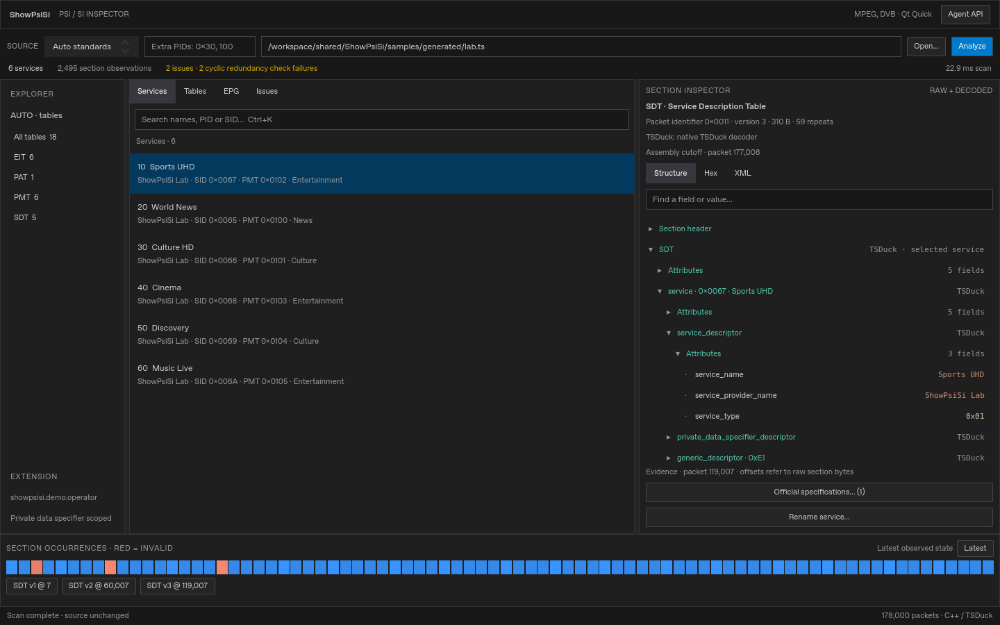
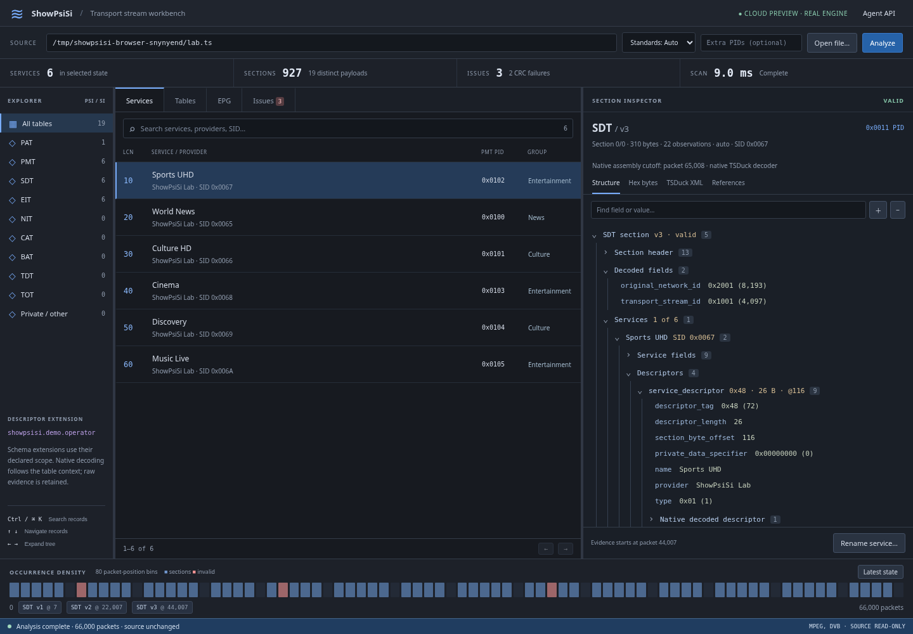
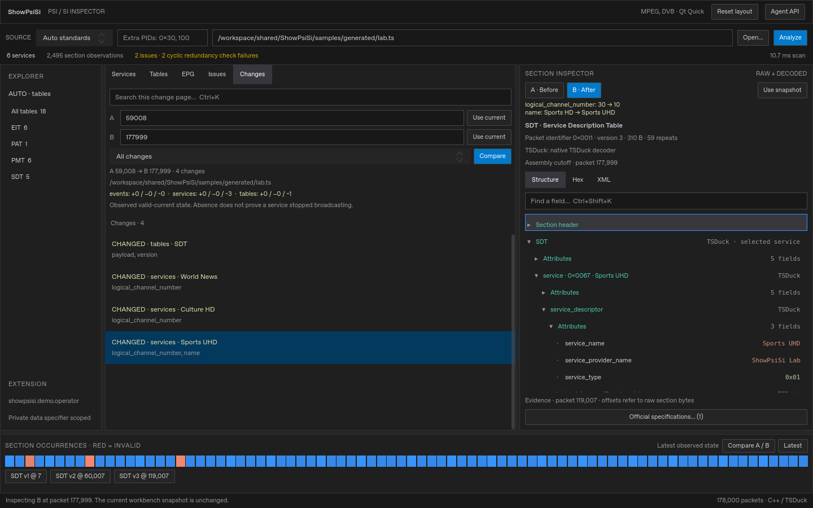
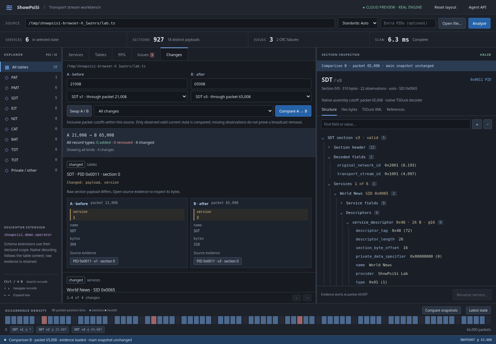
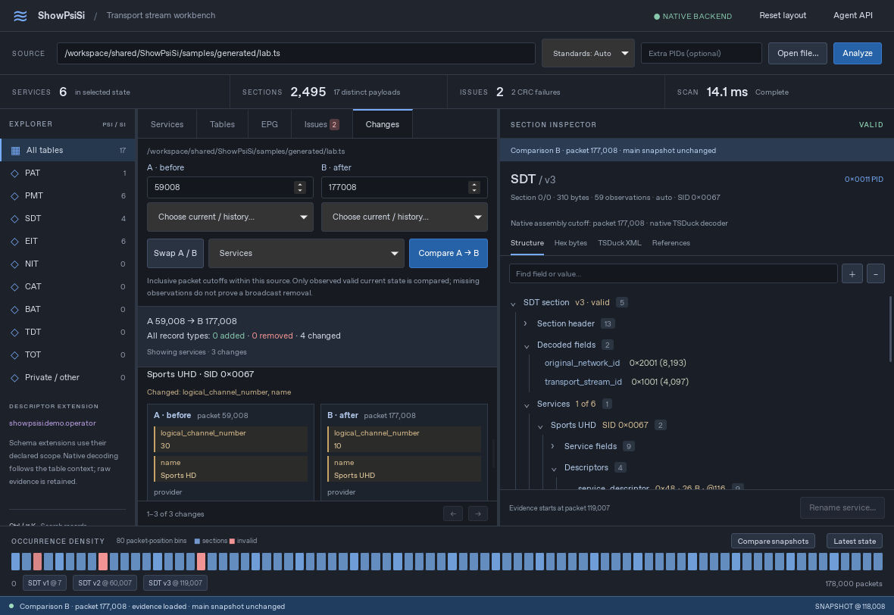
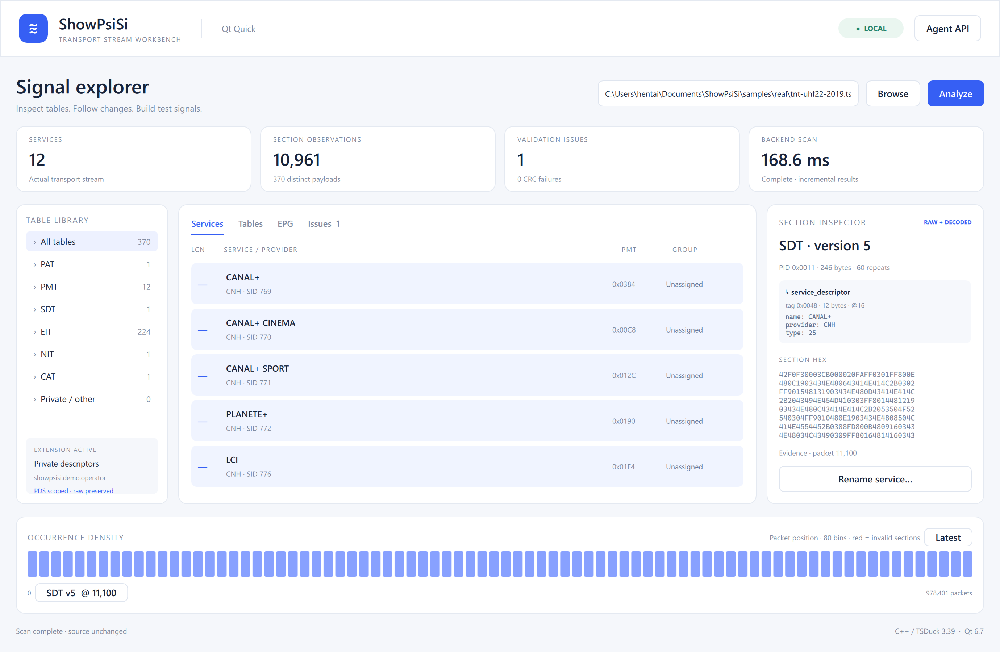
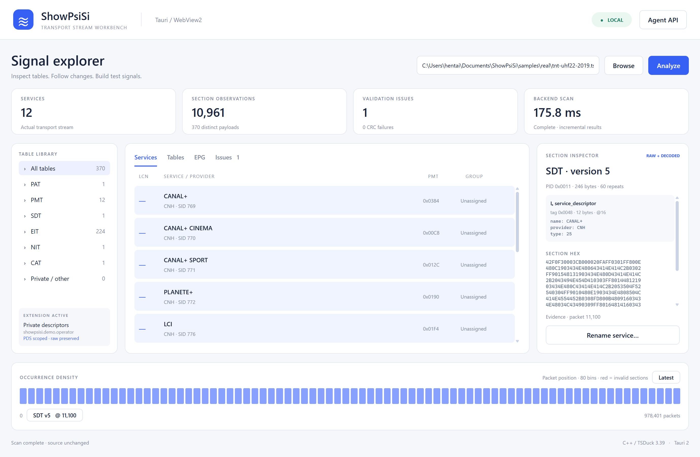

# ShowPsiSi

**Qt Quick 6.7.3** 与 **Tauri 2 / WebView2** 两套工作台，共用 **C++ / TSDuck 3.39-3956** 引擎。用于查看 MPEG-TS 的 PSI/SI 表、描述符、历史证据和安全编辑导出。它不是射频解调器，也不等于完整标准一致性认证工具。

本轮在独立 Linux 云环境开发：原生引擎、Qt 和 Linux Tauri 已构建并运行；Chromium 工作台也连接真实引擎验证。Linux 原生打开／保存对话框、编辑导出和回读已验证。原有 Windows 运行证据保留；新代码尚需 Windows WebView2 和 macOS 回归。

## 编辑器式工作台

- 中性深色布局、可调整并记忆的面板、一键恢复布局、可见焦点、键盘导航和记录搜索。
- 长文件扫描可取消，等待终止确认后重扫；未完成证据和预览不会混入后续结果。
- A/B 历史截面对比：查看表、服务与事件的新增、移除及字段变化，按各自时间定位原始证据。
- PSI/SI 结构树：表头、服务、描述符、嵌套字段；正确宽度的十六进制标识与缩写解释。
- Structure / Hex / XML 视图：原始字节、字节偏移与 TSDuck 原生解码并列可查。
- 显式 DVB / ATSC / ISDB（含日本、巴西）/ SCTE 上下文及额外 PID；自动模式存在标识冲突时不能替代专业判断。
- 小型官方标准链接索引，不内置 PDF，不联网解析；未匹配的私有含义保留为未知。系统无法打开链接时显示原因，可复制或手动选择完整 URL。

当前链接的 SDK 实际注册 **43 种表解码器、306 种描述符解码器**。这是可调用解码器清单，不是每种广播规范、每个运营商变体均已验证。DVB-S/T/C 的信令参数与调谐/接收能力是两回事；DTMB 没有专用解码器保证。见 [协议覆盖与测试边界](docs/PROTOCOL_COVERAGE.md)。

[需求审计与修复](docs/REQUIREMENTS_AUDIT.md) · [交互参考与视觉验收](docs/UI_UX_REVIEW.md) · [云端构建和排障](docs/CLOUD_DEVELOPMENT.md) · [测试命令](tests/README.md)

### 当前界面

Qt 原生软件渲染，合成码流：



Web 工作台，Chromium + 真实原生引擎；不是原生 Tauri 截图：



### A/B 历史变化

选择两个包位置或版本历史，查看变化并定位各自的原始证据。
对比不会自动改变当前工作台时间位置。





### Linux 原生 Tauri

已使用真实文件选择、改名预览、保存和回读验证，详见 [原生验证记录](docs/NATIVE_TAURI_VALIDATION.md)。



## 直接运行

首次克隆请先完成下方“构建与测试”中的依赖准备、编译和样流生成，然后在本项目 PowerShell 中运行。也可以双击 `Launch Qt.cmd` / `Launch Tauri.cmd`，默认打开含版本变化和故障的合成样流。

```powershell
.\scripts\run.ps1 -UI qt -Auto
.\scripts\run.ps1 -UI tauri -Auto
# 使用 TSDuck 的真实法国地面电视录制流：
.\scripts\run.ps1 -UI qt -Sample samples\real\tnt-uhf22-2019.ts -Auto
.\scripts\run.ps1 -UI tauri -Sample samples\real\tnt-uhf22-2019.ts -Auto
```

界面打开后可输入本机文件路径或使用 Browse。分别启动可避免同时运行影响性能判断。所有处理在本机完成。

Qt 改名预览后可选择 TS 或 BIN，再用 Save 选择可写的新输出路径；默认从用户文档／主目录开始，不写入安装目录的 `artifacts/`。取消保存会保留预览，已有输出文件或同名 manifest 会被拒绝。两种格式都只包含信令；BIN 需要保留相邻 manifest 才能追溯 PID，TS 不包含音视频／PCR，也不保留原始时序。

SDK 和构建产物位于工作区的 `.deps/`、`build/` 和 `ui/tauri/src-tauri/target/`，不包含在 Git 仓库中。此原型需要本机安装 TSDuck 开发包；尚未制作面向其他电脑的安装包。

## 已实现

- 通过 TSDuck `SectionDemux` 增量解析 188/192/204 字节文件；PAT 发现 PMT PID，另扫描常见 DVB SI PID 与 ATSC PSIP PID。
- section 的原始字节、PID、版本、current/next、包位置、重复次数、80 桶密度，以及 SDT 版本历史。
- DVB 实际 TS 的服务列表，PAT/PMT 关联，EIT 事件列表；标准 service / short-event 描述符由 TSDuck 解码。
- CRC、部分结构长度错误和 demux 连续性统计。无效数据保留，正常节目组织排除它们。
- 描述符字段树与十六进制；PDS + table-id 限定的私有配置解码；可配置频道排序和分组。
- 单 section 实际 SDT 的服务改名预览：TSDuck 编码、版本递增、CRC 重算；导出到新路径。
- SI-only `.ts`（可配置 null 包和重复次数）或 `.bin` 原始 section 文件，均附 PID、来源和修改记录 manifest。
- JSONL CLI 与 MCP stdio 接口。AI 调用的是真实后端功能，与 GUI 共用 schema 和验证规则。
- `cancel_analysis` 与 MCP 取消通知；请求 ID 精确匹配、进度隔离，正常输入结束仍处理已接受的请求。
- 只读 `diff_snapshots`，支持反向对比、类型筛选和有界分页；重复观测不误报为变化。
- 同版本重现、版本号回绕、同包多 section 的接收顺序均参与证据选择；非标准 PID 的 SDT 保留在表视图，不覆盖 PID 0x0011 的服务列表。

## 初始 Windows 原型与历史证据

以下截图来自两个实际运行的原型，使用同一份 TSDuck 官方真实样流。

**Qt Quick**



**Tauri + Web**



以下 `artifacts/` 文件是本地验证产物，不包含在仓库中，可使用下面的脚本重新生成：

- `artifacts/qt-quick.png`、`artifacts/tauri-web.png`：运行中的两个原型。
- `artifacts/*-issues.png`、`artifacts/*-edit.png`：错误检查和编辑交互。
- `artifacts/engine-tests.log`：后端、导出回读和 MCP 集成测试。
- `artifacts/qt-ui-test.json`、`artifacts/tauri-ui-test.json`：实际控件交互结果。
- [性能对比](docs/BENCHMARK.md)、[扩展和 AI 接口设计](docs/ARCHITECTURE.md)、[当前状态](docs/STATUS.md)。

## 构建与测试

当前 Windows 路线：PowerShell 7、VS 2019 Build Tools / MSVC 14.29、Windows SDK、TSDuck 开发包、CMake/Ninja、Python 3。先安装这些前置依赖并按实际位置调整 `scripts/env.ps1`；`setup-deps.ps1` 在项目内准备 Qt 6.7.3、Rust 1.99.1 和 Python 虚拟环境。详见 [依赖说明](docs/DEPENDENCIES.md)。环境脚本只设置当前进程环境。

```powershell
.\scripts\setup-deps.ps1
.\scripts\build.ps1
.\.deps\py\Scripts\python.exe scripts\make_fixture.py
.\.deps\py\Scripts\python.exe tests\test_engine.py
.\.deps\py\Scripts\python.exe scripts\qt_capture.py
.\.deps\py\Scripts\python.exe scripts\tauri_capture.py
.\.deps\py\Scripts\python.exe scripts\benchmark.py
```

浏览器 UI 检查使用 Playwright，仅连接测试进程自己的 WebView2 CDP 端口。正式性能测试关闭 CDP。Qt 检查通过自己窗口内的鼠标事件操作实际控件。自动检查完成后清理并确认自己启动的进程树退出。

依赖定位脚本目前按本机路径配置；新机器需调整。Tauri 的 Cargo.lock 已锁定版本；C++ 使用 vendored nlohmann/json 3.11.3。Linux 原生引擎、Qt、Tauri／WebKitGTK 和浏览器工作台已有本轮验证；新 Windows 与 macOS 尚未验证，不能称为所有平台完成。

## 样流

`scripts/make_fixture.py` 可重复生成含六个服务、SDT v1/v2/v3、私有描述符、2 个 CRC 错误和 1 个长度错误的信令流。无音视频/PCR，不是可播放黑画面。

真实样流来自 [TSDuck 官方流仓库](https://tsduck.io/streams/?stream=france-dttv)，包含 2019 年法国地面电视网络的 UHF22 和 UHF33 录制。下载来源、大小、SHA-256 及随附参考报告保存在 `samples/real/`。二进制样流不纳入源码分发。

## 本轮边界

暂未实现 UDP/SRT/调谐器输入、实时流回压/取消、大文件磁盘索引、完整 SPEC 检查、任意描述符编辑、节目增删联动、保留 PCR/码率/原始位置的完整 remux、私有 DLL 自动发现、实际 LLM 模型接入、完善的 EPG 时间网格和多语言 UI。

时间查询表示“该包位置之前完整接收到的、最新观察到的 current section 状态”。它不能证明节目在未观测区间仍有效。跨 section 的 PAT/PMT/SDT 不混版本，未收齐时不生成其派生服务；EIT 的分段语义仍需后续专门处理。

快照导出保留 PMT 中的媒体引用，但不带媒体/PCR；用于“信令存在、媒体缺失”的测试。要测试真正编码后的黑色视频、原始播发节奏或接收机的全部行为，需要另行构造相应媒体和时钟。`.bin` 本身没有 PID 或时间，必须配合 manifest。

未知私有字段作为原始字节保留，不推断其语义。当前“valid”指已实施的校验通过，不等于完全符合全部广播规范。
