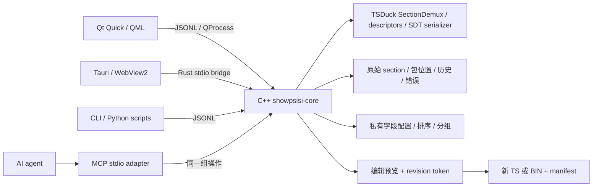

# 扩展与 AI 原生接口

## 当前运行结构



前端不解析 TS，也不自行改 CRC。两个原型调用同一个 exe，后端和输入的 SHA-256 记录在性能报告中。Tauri 的 Rust 层只管理进程、消息、文件选择和测量事件，业务逻辑留在 C++。

## 私有描述符：已经工作的配置路线

参见 `extensions/demo.json`。私有标签不能仅凭 tag 判断；这里使用 `(PDS, table_id, tag)` 三项限定，以免不同运营商的同号描述符被混淆。

样例在 SDT 的 service descriptor loop 中使用 `private_data_specifier = 0x53505349`，之后的 `tag = 0xE1` 负载为：

| 偏移 | 字段 | 类型 |
| --- | --- | --- |
| 0 | logical_channel_number | u16 大端 |
| 2 | group | u8，映射成 News / Culture / Entertainment |

未识别的 `0xE2` 仍保留为 `E204CAFEBABE`，没有臆造解码结果。描述符 loop 边界先验证，再运行字段配置；标准服务名/事件名交给 TSDuck 解码。

通过 `load_extension` 加载另一份 JSON，再 `analyze` 即可生效；`organization.sort_by` 和 `group_by` 从派生服务字段中选择排序与分组来源。集成测试已验证换 PDS 后解码不会误匹配、改变排序字段无需编译。

这一层只覆盖定长 u8/u16 字段。复杂循环、位域、加密负载、多表关联、私有表 ID 和运营商特有的完整节目组织，不适合无限堆叠 JSON 表达式。

## 复杂私有协议：后续 C++ 扩展路线

优先复用 TSDuck 的 `AbstractDescriptor` / `AbstractTable` 和 PSI 注册机制，按官方 [扩展开发说明](https://tsduck.io/docs/tsduck-dev.html) 编译与 SDK 版本匹配的模块，补充 XML 模型和名称文件。描述符解码与节目组织保持两个独立接口：

1. **协议模块**接收明确上下文（广播标准、PDS、registration id、table id、原始字节），返回字段、字节范围、错误，并可选实现 encode。
2. **组织模块**接收同一时间截面的完整表集合，返回频道/分组/LCN/EPG 关系，以及每个结果引用的 section ID 和字段位置。

组织结果是有来源的派生视图；只有显式编辑才生成修改。不能让“排序/分组”顺带修改捕获数据。配置之间冲突必须报告，未知字段始终可以回到 hex。

原型尚未实现任意 DLL 加载。正式接入时应固定插件 ABI 与 TSDuck 构建版本；可信原生插件可在引擎内运行，需要隔离故障或第三方脚本时采用独立 worker。当前框架已经有进程边界，但并不等于安全沙箱。

## AI 原生：已经可调用的能力

“AI 原生”在这里是操作接口和证据结构的设计，而不是在 UI 附加聊天框。

`api/tools.json` 是能力发现入口，同时用于后端参数验证和 MCP tools/list。当前操作：

| 操作 | 结果 |
| --- | --- |
| capabilities | schema、版本、能力边界 |
| analyze | 增量进度、服务/事件、历史、诊断 |
| query | 指定包位置的观察快照 |
| inspect | 原始 hex、字段、字节偏移、所有出现位置 |
| load_extension | 加载声明式协议规则，要求重新分析 |
| preview_rename | 修改前后、version/CRC、绑定当前 revision 的 token |
| export | 写新文件，返回来源与修改 manifest |

工作流可以是：“查询发生问题的版本 → 定位 CRC 或描述符字段 → 提议改名 → 检查预览 → 输出测试流 → 重新分析验证”。GUI、脚本、MCP 完全共享该路径，AI 无需模拟点击或识别截图。

JSONL 示例（每行一个 JSON 对象，同一进程内保留分析状态）：

```json
{"id":1,"method":"analyze","params":{"path":"C:/captures/input.ts"}}
{"id":2,"method":"query","params":{"at_packet":60000}}
{"id":3,"method":"inspect","params":{"id":"从 query 返回的 section id"}}
```

响应为 `{id,result}` 或 `{id,error:{code,message}}`；分析过程中还会出现 `{event:"progress",request_id,state}`。标准输出只输出协议数据。当前调用串行，长扫描期间还没有并发取消。

MCP 客户端的配置示例（不自动修改任何客户端配置）：

```json
{
  "mcpServers": {
    "showpsisi": {
      "command": "C:/path/to/ShowPsiSi/.deps/py/Scripts/python.exe",
      "args": ["C:/path/to/ShowPsiSi/scripts/mcp_server.py"]
    }
  }
}
```

MCP adapter 已通过 initialize、tools/list 和完整 tools/call 工作流：分析、查看原始证据、预览改名、导出、回读验证；中文服务名与中文输出路径也已覆盖。未测试特定外部 AI 客户端，也没有配置模型、API key 或自动授权客户端写文件。协议具备本机文件读取和新文件输出能力，应按客户端的实际授权范围接入。

后续优先增加 `diff_snapshots`、有字段 schema 的 `preview_patch`、批量事务、取消/进度、持久化证据索引和 export profile。届时可将工具结果进一步分页，避免把所有 EPG/出现位置一次性塞进 AI 上下文。
