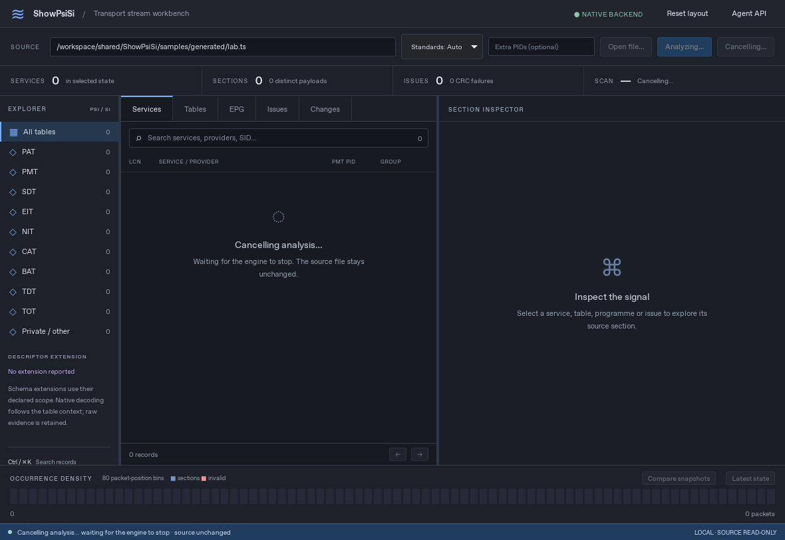

# Linux native Tauri validation

Cloud-only validation on 2026-10-16 UTC. This is the compiled Tauri application using WebKitGTK and the real C++ engine, not the loopback browser adapter. No owner computer or device was used. Windows WebView2/macOS native Tauri runtime remains untested. The Linux OS reference launcher was exercised in the later iteration below; its unsupported-operation failure is now surfaced, but no actual external browser navigation was verified.

## Build

Rust 1.99.1, locked Tauri 2.12.4, GTK 3.24.49 and WebKitGTK 2.52.6 on Debian 13. The initial baseline passed two reference-allowlist unit tests with `cargo test --locked --manifest-path ui/tauri/src-tauri/Cargo.toml`; the later iteration below passes seven tests. `cargo build --locked` builds the debug application. The build exposed the missing default `icons/icon.png`; the repository now includes an original RGBA icon. Runtime reporting now identifies WebKitGTK/WKWebView/WebView2 according to platform.

Ordinary Linux setup needs the distribution's GTK/WebKitGTK development/runtime packages and the TSDuck dependencies. This cloud workspace instead extracted official Debian packages into ignored `.deps/native-root`, installed official Rust into `.deps/rust`, and set `PKG_CONFIG_SYSROOT_DIR` and `PKG_CONFIG_LIBDIR` for the extracted pkg-config files. No system-wide package installation is required for that route.

Debian's WebKitGTK helper paths are compiled under `/usr/lib/x86_64-linux-gnu/webkit2gtk-4.1`. Setting `WEBKIT_EXEC_PATH` did not relocate this distribution build. A first launch therefore exited 133 with a missing WebKitNetworkProcess error. The successful cloud launch used bubblewrap to map the complete extracted library directory into that path in a disposable process mount namespace:

```sh
export SHOWPSISI_ROOT="$PWD" SHOWPSISI_AUTO=1
export LD_LIBRARY_PATH="$PWD/.deps/native-root/usr/lib/x86_64-linux-gnu:$PWD/.deps/tsduck/usr/lib:$PWD/.deps/tsduck/usr/lib/x86_64-linux-gnu"
export XDG_CACHE_HOME="$PWD/.deps/native-home/cache"
export XDG_DATA_HOME="$PWD/.deps/native-home/data"
export XDG_CONFIG_HOME="$PWD/.deps/native-home/config"
export WEBKIT_INJECTED_BUNDLE_PATH="$PWD/.deps/native-root/usr/lib/x86_64-linux-gnu/webkit2gtk-4.1/injected-bundle"
bwrap --ro-bind / / --dev-bind /dev /dev \
  --ro-bind "$PWD/.deps/native-root/usr/lib/x86_64-linux-gnu" /usr/lib/x86_64-linux-gnu \
  --bind "$PWD" "$PWD" \
  ./ui/tauri/src-tauri/target/debug/showpsisi-tauri
```

This preserves WebKit's sandbox. It changes neither host security settings nor host library files. The library mapping must include TSDuck's libusb, pcsclite, curl and rist dependencies; the initial incomplete mapping produced an accurately visible broken-pipe error. After completing dependencies and using writable workspace XDG directories, the successful runtime stderr was empty.

## Native interaction evidence

- Actual native workbench displayed six services, 18 distinct payloads, 2,495 section observations and the expected two CRC failures in the generated source.
- GTK Open File selected `samples/generated/lab.ts`; the application rescanned it.
- Native edit preview changed SID 103 from `Sports UHD` to `Native GTK Test`, SDT version 3 to 4, with recomputed CRC.
- GTK Save File exported a new `edited-si.ts` plus manifest: 404,200 bytes, 14 sections, 10 cycles. The test artifacts were then moved into ignored `artifacts/native-gtk-export.ts` and its manifest. The manifest preserves its original export destination.
- Independent native-core readback recovered the edited service and zero CRC errors.
- Repeating Save to the existing destination displayed GTK's replacement warning. Cancelling preserved both output hashes. This tests the native dialog's cancellation path; it does **not** claim that the warning's Replace branch was accepted. Backend no-overwrite and competing-writer tests are covered by the engine suite.
- Original source SHA-256 before and after: `528c8cd44e1289e8f1d3f59a457bb9247d1f9716df21a4f30c6c6d18cb37ff96`.
- Export SHA-256: `128984101c37eef93f55b550c03ee0ef5163f3950a1fe95a17a125938f9a51d9`; manifest SHA-256: `a2039b43748fa4bb4b6d2ef259a802c03f2369e4ea034ddbef09c22b62a2c2d0`.
- The app was closed normally after these checks; the launcher recorded exit code 0.

Local build/test logs, trace milestones, export readback and hashes are in ignored validation artifacts. Negative URL tests exercise exact registry matching, rejection of non-HTTPS schemes and control characters without opening an external browser. These are not full standards-conformance or performance claims.

## Baseline backend lifecycle and build

The Rust bridge now emits `backend_exit` on stdout EOF/read failure, checks child exit before accepting a request, and reports `backend_alive` at boot. The Web UI rejects pending work, clears busy/loading state, disables backend-dependent actions and visibly requests an application restart. It does not restart the engine or retry edits automatically.

Controlled process fixtures verified both a child exiting three seconds into a pending analysis and a child exiting before the UI listener was installed. Both produced the disconnected state instead of hanging. These failure fixtures intentionally do not parse data; all positive analysis/export checks above used the real engine.

After the final embedded web-asset rebuild, the real engine successfully scanned the source again and the native screenshot was recaptured. Closing this final real-engine run returned exit code 0. Process snapshots verified that its Tauri process, core child, WebKitNetworkProcess and WebKitWebProcess were absent after exit; unrelated validation processes were left alone.

Baseline native executable SHA-256: `0d9ac8c4cce1695b93317509abd8bbbd4fe421d0239daf6f49abc2ec15a58e37`.
Rust source SHA-256: `e876188931b9cb9b0d8ff7495d79d581668099d4751d2c7de80eff1e8a1ba8ec`.
Embedded `app.js` SHA-256: `2175e3443d840077faa24e9110a236c480506a76ab5cf28ba496297f0e8b2d97`.
Machine-readable local evidence: `artifacts/native-tauri-validation.json`.

## Persistent layout and snapshot comparison iteration

Validated on 2026-10-16 UTC using the same sandbox-preserving native route, the real engine, and the final embedded Web assets. All positive checks used `samples/generated/lab.ts`.

- Dragged the explorer to 218 px and inspector to 470 px; keyboard resizing changed the inspector to 454 px. Closing and reopening the app retained the 218/454 widths. The workspace profile's WebKit local storage recorded the versioned layout value. Reset layout restored the defaults and removed the saved value.
- Exercised the right splitter's maximum and narrowed the native window to 1,100 px. The center pane remained visible at its 260 px minimum. Reset layout remained available.
- Pinned the main workspace to SDT v2 at packet 118,008. Compared A at 59,008 (SDT v1) with B at 177,008 (SDT v3). The real engine returned four changed records: one table and three services, with zero added/removed records. The Services filter returned three changes.
- The Sports service showed highlighted changes from `Sports HD` to `Sports UHD` and LCN 30 to 10. World News changed LCN 10 to 20, and Culture HD changed 20 to 30.
- Opening A and B source evidence displayed SDT v1/cutoff 59,008 and SDT v3/cutoff 177,008 respectively. The main footer stayed at snapshot 118,008, comparison evidence was labelled, and rename remained disabled in comparison inspection. Returning to Services restored the previous SDT v2 detail.
- Rebuilt once more after the reference-launcher/fallback fix. The final native app repeated the service comparison and B-evidence check. The screenshot below is an actual 1,180 × 812 client capture of that final executable, re-encoded from the captured JPEG to PNG without adding or replacing UI content.


### Reference launch failure and recovery

Clicking the exact registry URL for ETSI EN 300 468 invoked the system helper. A temporary workspace-only diagnostic wrapper around `/usr/bin/xdg-open` recorded exit status 4 and `gio: ... Operation not supported`. No browser tab navigated to the specification. The initial Rust implementation had treated process spawn as success and discarded the helper's exit status and stderr.

The bridge now runs that helper off the UI thread, waits at most five seconds for confirmation, reports nonzero exit/spawn failures, and continuously drains stderr while retaining at most 512 bytes. A timeout reports that opening could not be confirmed and reaps the helper in the background without killing a possible browser process. Exact HTTPS registry matching is unchanged. A zero exit means only that the OS helper accepted the request; it does not verify a visible browser page.

In the final native run, the genuine exit-4 failure appeared next to the reference and in the footer. Copy URL then reported success and cleared both error messages. The read-only URL was also selectable with Ctrl+A. The final browser regression separately exercises clipboard denial, manual selection guidance, successful clipboard copy, and stale-error clearing. No host browser configuration or security settings were changed. Actual external browser opening remains unverified in this cloud runtime.

### Final tests, source integrity and shutdown

- Locked Rust tests: **7 passed**, covering the two URL guards plus successful helper exit, nonzero exit, missing helper, bounded/drained diagnostics, and timeout. No test launches an external URL.
- Final real-engine browser suite: **16 passed**. It complements rather than substitutes for the native checks above.
- All five positive/diagnostic native runs closed normally with exit code 0. The final run's stderr was empty. Its Tauri and engine processes were absent at the post-close snapshot; the WebKit helpers were exited/defunct briefly and subsequently absent on the later PID check. No unrelated process was terminated.
- Source SHA-256 was identical before and after: `528c8cd44e1289e8f1d3f59a457bb9247d1f9716df21a4f30c6c6d18cb37ff96`. Comparison and reference checks did not mutate the transport stream.

Final build identities:

- Native executable: `755de3b2e89a22563bef494e4f154642c0bf3527ebaf12d8a08772f6c9637ab8`
- Rust source: `58cb830cbfe8fd448cfc3eac9c9feb54aca9809bbfaa3d67a6b8d4add0bbe6be`
- Embedded `app.js`: `98dd7f5baa14b182706444a4723f707003b2739bbd9c72ff254fff7c2adc9467`
- Embedded `style.css`: `bd580cf012111ce50acbe2ba6b156db5ca1b68444d2cb79d59dd4691e6e90744`
- Native engine: `3bab3ff812b92ea1ed31aa7ab85f572f5133d8c30f6602022bb02e89a65cd97b`

Ignored local evidence: `artifacts/native-tauri-next-validation.json`, `native-next-cargo-{test,build}.log`, `native-next-run-*.{before,after}.sha256`, layout/reopen/narrow/comparison/reference screenshots, `native-reference-launcher.log`, and process snapshots. The earlier `native-tauri-validation.json` remains baseline evidence, not the identity of this final build.

## Cooperative cancellation iteration

Validated on 2026-10-16 UTC on the assistant's own Linux cloud desktop, using the
same sandbox-preserving WebKitGTK launcher above. The final embedded Web assets
were rebuilt after independent review fixed failed-scan cleanup and late/foreign
progress handling. No Rust bridge changes, owner computer, Windows WebView2 or
macOS runtime were involved in this iteration.

### Native interaction and fixture boundary

- The actual native app displayed Cancel while analyzing the real generated
  `samples/generated/lab.ts`. For deterministic interruption, this run selected
  the separately compiled `showpsisi-core-test` executable with its one-shot
  `after_progress` checkpoint; the production executable has no such gate.
- After the checkpoint, only that app's identified helper child was temporarily
  stopped with SIGSTOP. Clicking Cancel immediately cleared partial records and
  showed disabled Cancelling and Analyze controls. SIGCONT then allowed the real
  cancellation request to run. The app received its `analysis_cancelled` terminal
  response and showed Analysis cancelled, zero records, source unchanged and an
  enabled Analyze button. The deliberate pause is not cancellation-latency evidence.
- Focus returned to Analyze. Pressing Enter rescanned successfully in the same
  native/helper process, with six services, 18 distinct payloads, 2,495 observations,
  the expected two CRC failures and the SDT v3 inspector. The one-shot checkpoint
  did not affect this rescan.
- A separate final native launch selected the ordinary production core, without
  any test gate or process pause. Initial scan and a second Analyze click both
  returned the same six-service result and working section inspection.



The screenshot is the actual 1,180 × 812 native client capture, re-encoded to PNG
without adding or replacing interface content. Browser-only tests separately
cover cancellation before analysis, after progress and immediately before
completion; cancellation/completion races; original-terminal waiting; failed
cancellation delivery and retry; stale inspection/query/comparison/edit replies;
unknown or malformed events; same-batch terminal then late progress; failed-scan
cleanup; keyboard focus; and 520/761/900 px layouts. Their positive results come
from the native engine; invalid-event tests explicitly inject malformed envelopes.

### Final verification and integrity

- Locked Rust tests: **7 passed**; final debug native executable rebuilt successfully.
- Final real-engine Chromium suite: **24 passed**, no skipped tests, exit code 0.
  Chromium's sandbox was explicitly enabled. A restricted-shell launch initially
  failed before any test because its socket operations were unavailable; the
  supported cloud desktop launch ran the complete suite successfully.
- Both final native runs closed normally with exit code 0 and empty stderr.
  Their Tauri, core and launcher processes were absent in the final process
  snapshot. WebKit network/web helper entries had exited and remained defunct,
  reparented to PID 1 awaiting host reaping; they were not running workers. No
  unrelated process was terminated.
- Source SHA-256 matched before and after both final native runs:
  `528c8cd44e1289e8f1d3f59a457bb9247d1f9716df21a4f30c6c6d18cb37ff96`.

Final identities:

- Native executable: `a38a5341dd3319b2749952bddbc09935c77044610afc00c56bcd3dd2f92817b9`
- Embedded `app.js`: `0d965fe1c37b3f722712a979782de578cb042b41d9933b88c22b14e02ab6397a`
- Embedded `style.css`: `bd580cf012111ce50acbe2ba6b156db5ca1b68444d2cb79d59dd4691e6e90744`
- Production engine: `1351929f70a6e8c01ab9ed72d08dcfea47951c051a45961095a61206dc56b213`
- Separate gated test engine: `af8507d6a7bf362e67f13207be576e0a5afe9656ea1ff2e41fb4359fdca80e0f`

Ignored evidence: `artifacts/native-tauri-cancellation-validation.json`,
`native-cancellation-{gated,production}.*`, `native-cancellation-cargo-*.log`,
`native-cancellation-final-processes.log`, `web-cancellation.log`,
`web-cancellation-exit.txt`, `web-cancellation-final.inputs.sha256` and
`web-ui-tests/cancellation-pending-narrow.png`. These results do not establish
Windows/macOS interaction, installers, external-browser launching or performance.
